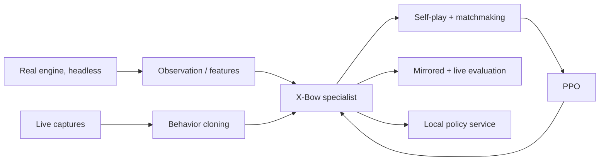

# ClashMaster

Clash Royale AI research workspace targeting **top ladder on Null's Royale
16.635.1** (`nullsroyale.rel.free`) with **any opponent/deck**, not a mirror
matchup.

**Model:** **FirstLight V4 General** (12.68M parameters, trained across decks) is
the baseline, the PPO initialization and a frozen league opponent. IL, Active IL
and the Hog 2.6 specialists are opponents/baselines. **The learner deck is fixed
to X-Bow 3.0**; match variety comes from the opponent pool + deck pool.

**Current phase:** **N0–N3 pass; the bulk-training substrate decision is made
(2026-11-15).** The 16.635.1 offline APK/probe runs on the A51, and the same
client build runs headless on this Linux host as an x86_64 engine. That engine is
now the **promotion gate, the parity oracle and the deploy rig** — not the bulk
trainer. The native path's Python per-packet data path caps it at **0.082
matches/s per process** and left the rented A6000 at **4 % utilisation**.

**Bulk trainer:** **crforge `VectorBattle`** (16.635.3/8 tables, 256 lanes,
zero-copy NumPy), measured at **2.6 / 6.0 / 13.0 matches/s** at 1/4/8 threads on
this laptop and **18.5–52.5** on an M4 Pro. The C1 spike (2026-11-16) measured
the vectorized observation frame at **~0.03 ms/lane (35k decisions/s)** and
`UniversalObservationTensorizerV4` at **~1.4 ms/lane**; the tensorizer is now
the packet budget, not the observation build. See
[`ROADMAP_CRFORGE.md`](ROADMAP_CRFORGE.md).

**Next milestone:** finish the C0 legality soak (9/20 clean at the 2026-11-16
handoff), then **C3**: the C1 spike measured the vectorized encoder at ~0.03
ms/lane (35k decisions/s) but `UniversalObservationTensorizerV4` at ~1.4
ms/lane, so the tensorizer — not observation facts — is the remaining packet.
Promotion stays on the native engine: **never on crforge.** Official Supercell
servers are out of scope.

This repository is a fork of
[FirstLight_CR](https://github.com/Jaasssoooonnnnn/FirstLight_CR). The upstream documentation follows
below. Project-specific additions:

- **[ROADMAP.md](ROADMAP.md)** — the single plan: runtime bring-up, API/deck, throughput, training,
  parity/live, QA harness.
- **[ROADMAP_CRFORGE.md](ROADMAP_CRFORGE.md)** — bulk-training plan of record: C0–C7
  gates, fidelity contract, economics, CI/parity role.
- **[docs/native/LINUX_BIONIC_RUNTIME.md](docs/native/LINUX_BIONIC_RUNTIME.md)** — runtime details,
  bundle hashes, install/smoke commands.
- **[HANDOFF.md](HANDOFF.md)** — current state, measured facts, next actions.
- **Sync upstream:** `./scripts/sync-upstream.sh`, or manually
  `git fetch upstream && git merge upstream/main && git push origin main`.
- **Replay dataset:** `IL_Replay` (`datasets/royaleapi/`) is the **generalist
  pretraining/fine-tune corpus**: 252,238 replays and 17,836,160 actions. The
  General checkpoint was trained from it. Self-play on the Null's 16.635.1
  engine supplies target-specific data.
- **Versions:** **16.635.1** is the primary/deployment target; **15.535.29
  x86_64** is a proxy lab and parity reference. Do not mix versions, bundles or
  `libg` hashes in one artifact.
  The laptop handles bring-up/demos; use the student cloud credits for the larger x86 host and PPO.
- **Remotes:** `origin` = this repo, `upstream` = `Jaasssoooonnnnn/FirstLight_CR`,
  `fork` = `rajerthat1/FirstLight_CR` (pristine mirror for upstream PRs).


> **Video: the model's Hall of Fame push and a walkthrough of the AI architecture**
>
## Pretrained models

A newer model, Everlight, is on the [`yes-delay`](https://github.com/Jaasssoooonnnnn/FirstLight_CR/tree/yes-delay) branch. It has a larger network and plays with the real game's timing: a card takes effect 20 ticks (1 second) after it is played.

**General is a strong model across decks. The author used the Hog 2.6 specialist to reach Hall of Fame.**

The [training history](docs/training_history.md) covers how the models were trained and evaluated.

Choose **General** for different decks or a **Hog 2.6 specialist** for Hog Cycle. Both are included in the repository. See the [model guide](checkpoints/README.md) for checkpoint details and evaluation.

## Features

- **Native battle environment.** Headless and rendered execution, structured observations, card deployment and abilities, with Python `reset` / `step` interfaces.
- **Imitation learning.** Reconstruct Parquet replays in the engine and build observation/action sequences for IL training.
- **Self-play reinforcement learning.** PPO with matchmaking, opponent pools, resident simulation, and distributed collection.
- **Models and inputs.** The V4 actor-critic uses card features, entity relations, spatial features, and recurrent memory. Training, evaluation, and local inference use the same model and input format.
- **Match and replay interface.** Play against a model, control both sides manually, or watch training and collected replays in one offline VM.
- **Source code.** The probe, APK build tools, battle environment, and training code are included.

**122 supported cards · 5 included checkpoints · self-play + live captures**

See [compatibility data](native_runner/data/competitive/README.md) for the cards and forms supported by each version. In this fork the V4 General checkpoint is the primary baseline and PPO initialization; IL_Replay is the generalist corpus, and the other checkpoints are opponents/baselines.

## Training flow



The upstream replay-dataset → IL path is retired in this fork; see [`ROADMAP.md`](ROADMAP.md). The
[architecture guide](docs/architecture.md) covers source entry points and data formats.

## Quick start

For a fresh machine or coding-agent setup, follow the [installation guide](docs/getting_started.md). The steps below are a summary.

**Desktop:** Windows, Python 3.12 with Tkinter, and an Android 12 instance of regular MuMu Player with root and ARM64 application support. CPU inference is supported. Building the offline APK from source requires JDK 17, Android NDK, and SDK build-tools; running an already built APK does not.

Run from the repository root:

```powershell
python -m venv .venv
.\.venv\Scripts\python.exe -m pip install -r requirements.txt
Copy-Item .env.example .env
```

Fill the Python, VM, and build-tool settings in `.env` using the [installation guide](docs/getting_started.md). The supported engine is **Null’s Royale 15.535.13 / arm64-v8a with content update 15.535.86**.

**First, install and open the unmodified original APK in the selected MuMu instance so it writes its `update/` folder, then exit.** The pinned `15.535.86` update is no longer served, so the client only writes `update/fingerprint.json` for the base `15.535.3` pack and never reaches the lobby; that base pack is enough to play matches but not to satisfy `production_ready`. Keep the original APK as `user-provided/nulls-royale.apk`. Check the original APK and downloaded resources before building or injecting the probe:

```powershell
./check_original_game.ps1 -InputApk ./user-provided/nulls-royale.apk
./build_offline_engine.ps1 `
  -InputApk ./user-provided/nulls-royale.apk `
  -OutputApk ./build/cr-ai-offline.apk
./install_offline_engine.ps1 -Apk ./build/cr-ai-offline.apk
```

To open the interface after installation, run `FirstLight_CR\launch_interface.cmd` from its parent folder, or run `./launch_interface.cmd` from the repository root.

## Train and evaluate

This fork trains by **self-play on the native engine for the promotion gate and
on crforge for bulk throughput**, with live captures for behavior cloning and
validation. Generate a small workflow example with `python tools/make_demo_data.py`. The [training guide](docs/training.md) covers cache generation, engine clusters, Linux AVD preparation, and distributed PPO; the upstream IL path remains for reference only.

To compare two included checkpoints, stop any console task and run:

```powershell
./native_runner/start_offline.ps1
.\.venv\Scripts\python.exe -m native_runner.training.v4.evaluate `
  --checkpoint-a ./checkpoints/General/checkpoint-step-00000460.pt `
  --checkpoint-b ./checkpoints/IL/checkpoint-step-00029396.pt `
  --games 2 --sample --output ./evaluations/comparison
```

Use `--games` for the match count, `--match-config` for decks and levels, and `--seed` for the starting seed. See [model evaluation](checkpoints/README.md#evaluation--模型评测) for results and metrics. To integrate your own actor loop, use the [JSON-lines policy service](docs/policy_service.md).

## Documentation

| Guide | Contents |
| --- | --- |
| [Getting started](docs/getting_started.md) | Requirements, `.env`, original game update, and offline installation |
| [Training history](docs/training_history.md) | Five main models, experiments, results, and playstyle tradeoffs |
| [Training](docs/training.md) | Replay cache, IL, batch simulation, Linux guests, and PPO |
| [Architecture](docs/architecture.md) | Environment, policy, training, and replay source map |
| [Models](checkpoints/README.md) | Model selection, loading, and evaluation metrics |
| [Policy service](docs/policy_service.md) | Recurrent episode lifecycle and request protocol |
| [Compatibility data](native_runner/data/competitive/README.md) | Card support, model catalogs, and version maintenance |
| [Checks](docs/validation.md) | Environment checks, tests, and runtime result checks |

## License

ClashMaster is released under the [MIT License](LICENSE). It builds on FirstLight CR,
which is Apache-2.0; the upstream copyright notice and attribution are preserved in
this repository's history.
