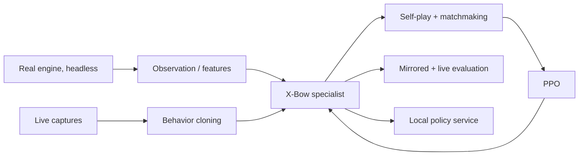

# ClashMaster

Clash Royale AI research workspace targeting **Ultimate Champion on the main ladder** with
**X-Bow 3.0**. Hog 2.6 is kept as an opponent and baseline, not a deployment stage.

**Model:** **X-Bow 3.0 specialist first** — the deck is exactly FirstLight-Zero's, so its 1.17M
CNN + LSTM recipe and v1450 checkpoint are the starting point. Training is **3a mirror bootstrap →
3b matchup pool** (General/IL/Hog/scripted/live). The FirstLight_CR V4 / Everlight 16.8M models are
generalists, opponents, and fallbacks.

**Current phase:** **native-engine route (Option E)**. The real Clash Royale engine runs headless
through FirstLight's probe/runner; the target client is **16.635.1**. Frida/static analysis is used
to port the probe; an extracted `libg.so` headless process is preferred for speed. **crforge is a
fallback and CI oracle only**, not the critical path.

**Next milestone:** a scripted X-Bow bot playing live on Null's 16.635.1, then a learned X-Bow bot
that beats it and is ready for a main-ladder canary.

This repository is a fork of
[FirstLight_CR](https://github.com/Jaasssoooonnnnn/FirstLight_CR). The upstream documentation follows
below. Project-specific additions:

- **[ROADMAP.md](ROADMAP.md)** — the single source: engine decision, Phases 0–4 + main-ladder gate, QA harness.
- **[ROADMAP_CRFORGE.md](ROADMAP_CRFORGE.md)** — optional crforge fallback / CI roadmap.
- **[HANDOFF.md](HANDOFF.md)** — current state, measured facts, next actions.
- **Sync upstream:** `./scripts/sync-upstream.sh`, or manually
  `git fetch upstream && git merge upstream/main && git push origin main`.
- **Replay dataset:** `IL_Replay` is **retired as a training corpus** in this fork. The X-Bow
  specialist is trained by self-play, with live captures for behavior cloning and validation. The
  IL/General/Everlight checkpoints are kept as opponents, baselines, and fallbacks.
- **15.535 vs 16.635:** the upstream 15.535.13 / 15.535.86 install below is the **offline training
  lab** (run it on Windows/MuMu or a Linux AVD). Live play and the probe target are 16.635.1; see
  `ROADMAP.md`. The laptop handles demos/live/light training; use the student cloud GPU credits
  for PPO.
- **Remotes:** `origin` = this repo, `upstream` = `Jaasssoooonnnnn/FirstLight_CR`,
  `fork` = `rajerthat1/FirstLight_CR` (pristine mirror for upstream PRs).

---

<p align="center">
  
</p>
<h1 align="center">FirstLight CR</h1>
<p align="center"><strong>From replays to agents. From self-play to the arena.</strong></p>
<p align="center">Train Clash Royale agents and play offline, with imitation learning and PPO self-play.</p>
<p align="center"><strong>English</strong> · <a href="README.zh-CN.md">简体中文</a></p>
<p align="center">
  <a href="LICENSE"></a>
  
  
</p>
<p align="center">
  <a href="docs/getting_started.md">Installation</a> ·
  <a href="docs/training.md">Training</a> ·
  <a href="docs/training_history.md">Training history</a> ·
  <a href="checkpoints/README.md">Models</a> ·
  <a href="docs/architecture.md">Architecture</a> ·
  <a href="docs/policy_service.md">Policy API</a>
</p>

<p align="center">
  
</p>

> **Video: the model's Hall of Fame push and a walkthrough of the AI architecture**
>
> [Watch in English (YouTube)](https://www.youtube.com/watch?v=TpfhzVlXWqw&lc=UgyyW1z5iYdLX8BZ0xl4AaABAg) · [观看中文版（哔哩哔哩）](https://www.bilibili.com/video/BV17Zb46JE9h)

## Pretrained models

A newer model, Everlight, is on the [`yes-delay`](https://github.com/Jaasssoooonnnnn/FirstLight_CR/tree/yes-delay) branch. It has a larger network and plays with the real game's timing: a card takes effect 20 ticks (1 second) after it is played.

**General is a strong model across decks. The author used the Hog 2.6 specialist to reach Hall of Fame.**

The [training history](docs/training_history.md) covers how the models were trained and evaluated.

Choose **General** for different decks or a **Hog 2.6 specialist** for Hog Cycle. Both are included in the repository. See the [model guide](checkpoints/README.md) for checkpoint details and evaluation.

## Features

- **Native battle environment.** Headless and rendered execution, structured observations, card deployment and abilities, with Python `reset` / `step` interfaces.
- **Imitation learning.** Reconstruct Parquet replays in the engine and build observation/action sequences for IL training.
- **Self-play reinforcement learning.** PPO with matchmaking, opponent pools, resident simulation, and distributed collection.
- **Models and inputs.** The V4 actor-critic uses card features, entity relations, spatial features, and recurrent memory. Training, evaluation, and local inference use the same model and input format.
- **Match and replay interface.** Play against a model, control both sides manually, or watch training and collected replays in one offline VM.
- **Source code.** The probe, APK build tools, battle environment, and training code are included.

**122 supported cards · 5 included checkpoints · self-play + live captures**

See [compatibility data](native_runner/data/competitive/README.md) for the cards and forms supported by each version. The upstream replay dataset is **retired as a training corpus** in this fork; the checkpoints are kept as opponents, baselines, and fallbacks.

## Training flow



The upstream replay-dataset → IL path is retired in this fork; see [`ROADMAP.md`](ROADMAP.md). The
[architecture guide](docs/architecture.md) covers source entry points and data formats.

## Quick start

For a fresh machine or coding-agent setup, follow the [installation guide](docs/getting_started.md). The steps below are a summary.

**Desktop:** Windows, Python 3.12 with Tkinter, and an Android 12 instance of regular MuMu Player with root and ARM64 application support. CPU inference is supported. Building the offline APK from source requires JDK 17, Android NDK, and SDK build-tools; running an already built APK does not.

Run from the repository root:

```powershell
python -m venv .venv
.\.venv\Scripts\python.exe -m pip install -r requirements.txt
Copy-Item .env.example .env
```

Fill the Python, VM, and build-tool settings in `.env` using the [installation guide](docs/getting_started.md). The supported engine is **Null’s Royale 15.535.13 / arm64-v8a with content update 15.535.86**.

**First, install and open the unmodified original APK in the selected MuMu instance so it writes its `update/` folder, then exit.** The pinned `15.535.86` update is no longer served, so the client only writes `update/fingerprint.json` for the base `15.535.3` pack and never reaches the lobby; that base pack is enough to play matches but not to satisfy `production_ready`. Keep the original APK as `user-provided/nulls-royale.apk`. Check the original APK and downloaded resources before building or injecting the probe:

```powershell
./check_original_game.ps1 -InputApk ./user-provided/nulls-royale.apk
./build_offline_engine.ps1 `
  -InputApk ./user-provided/nulls-royale.apk `
  -OutputApk ./build/cr-ai-offline.apk
./install_offline_engine.ps1 -Apk ./build/cr-ai-offline.apk
```

To open the interface after installation, run `FirstLight_CR\launch_interface.cmd` from its parent folder, or run `./launch_interface.cmd` from the repository root.

## Train and evaluate

This fork trains the X-Bow specialist by **self-play on the native engine**, with live captures for behavior cloning and validation. Generate a small workflow example with `python tools/make_demo_data.py`. The [training guide](docs/training.md) covers cache generation, engine clusters, Linux AVD preparation, and distributed PPO; the upstream IL path remains for reference only.

To compare two included checkpoints, stop any console task and run:

```powershell
./native_runner/start_offline.ps1
.\.venv\Scripts\python.exe -m native_runner.training.v4.evaluate `
  --checkpoint-a ./checkpoints/General/checkpoint-step-00000460.pt `
  --checkpoint-b ./checkpoints/IL/checkpoint-step-00029396.pt `
  --games 2 --output ./evaluations/comparison
```

Use `--games` for the match count, `--match-config` for decks and levels, and `--seed` for the starting seed. See [model evaluation](checkpoints/README.md#evaluation--模型评测) for results and metrics. To integrate your own actor loop, use the [JSON-lines policy service](docs/policy_service.md).

## Documentation

| Guide | Contents |
| --- | --- |
| [Getting started](docs/getting_started.md) | Requirements, `.env`, original game update, and offline installation |
| [Training history](docs/training_history.md) | Five main models, experiments, results, and playstyle tradeoffs |
| [Training](docs/training.md) | Replay cache, IL, batch simulation, Linux guests, and PPO |
| [Architecture](docs/architecture.md) | Environment, policy, training, and replay source map |
| [Models](checkpoints/README.md) | Model selection, loading, and evaluation metrics |
| [Policy service](docs/policy_service.md) | Recurrent episode lifecycle and request protocol |
| [Compatibility data](native_runner/data/competitive/README.md) | Card support, model catalogs, and version maintenance |
| [Checks](docs/validation.md) | Environment checks, tests, and runtime result checks |

## License

FirstLight CR is an independent offline project under [Apache-2.0](LICENSE), unaffiliated with Supercell. The repository does not distribute the game APK or its resources; users supply the supported APK locally. See [NOTICE](NOTICE).
